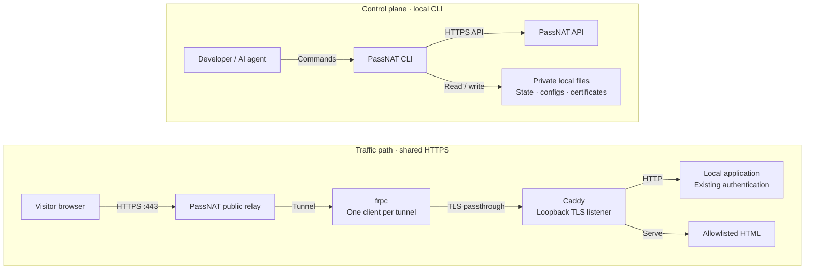

<p align="center">
  
</p>

<h1 align="center">Local services. Public HTTPS.</h1>

<p align="center">
  A PassNAT command-line tool for demos, collaboration, and sharing static pages.<br />
  Share one tunnel across multiple sites. Review changes before applying them.
</p>

<p align="center">
  <strong>English</strong> | <a href="README.zh-CN.md">简体中文</a>
</p>

<p align="center">
  <a href="https://github.com/zxbdzh/passnat-cli/actions/workflows/tests.yml"></a>
  <a href="pyproject.toml"></a>
  <a href="LICENSE"></a>
</p>

<p align="center">
  <a href="#quick-start">Quick start</a> ·
  <a href="#architecture">Architecture</a> ·
  <a href="#install-with-an-ai-assistant">AI-assisted install</a> ·
  <a href="https://zxbdzh.github.io/passnat-cli/">Docs (中文)</a> ·
  <a href="SECURITY.md">Security (中文)</a> ·
  <a href="https://github.com/zxbdzh/passnat-cli/issues">Issues</a>
</p>

> [!NOTE]
> **Unofficial community project.** Not affiliated with PassNAT. Using the service requires your own authorized PassNAT account and SecretKey; installation and offline checks do not require credentials.

## Why PassNAT CLI

Sharing a local feature should not expose an entire directory. Adding another demo should not mean starting another tunnel client that competes for the same connection.

| What you need | How it works |
| :--- | :--- |
| **Let others try a local app** | Caddy serves trusted HTTPS while the app keeps its existing login and permissions. |
| **Share multiple sites** | One shared tunnel, one frpc, one Caddy. Add sites by reloading the existing setup. |
| **Share a few static pages** | Allowlist individual HTML files instead of exposing directory listings, configuration files, or the whole repository. |
| **Automate with scripts or AI** | Structured JSON, explicit exit codes, and dry runs by default for platform resource writes. |
| **Take a demo offline** | Verify recorded ownership and the full mapping parameters before cleanup; do not take over unrecognized resources. |

**Shared by default, dedicated when needed.** Manage shared sites or create a dedicated preview without changing your application's source code.

## Routing rules

Decide the scenario before creating resources. When unsure, run the local planner first — it reads no credentials, makes no network calls, and writes no state:

```sh
passnat plan --device same --protocol https --apps 2
```

| Scenario | Use | Do not |
| :--- | :--- | :--- |
| **Same device, multiple HTTPS apps** | Reuse one base: register with `shared site`, hot-reload with `shared sync --reload --apply`; create the first mapping with `tunnels create --caddy-tls-port` | Create a second tunnel or a second frpc for the next app |
| **Same device, single HTTPS app** | Dedicated `preview up`: register the tunnel's first mapping with `tunnels create --caddy-tls-port 443`, then run Caddy with `preview run NAME proxy` | Auto-apply shared reuse |
| **HTTP / TCP / UDP** | HTTP: `tunnels create --protocol http`. TCP: `ports add --protocol tcp --remote-port …` on an existing tunnel — TCP cannot be a `tunnels create` first mapping. UDP is not supported and returns `unsupported_protocol` | Enter the Caddy HTTPS shared flow, or pretend TCP can be a first mapping or that UDP works |
| **Different devices** | An independent tunnel and frpc identity on the target device | Reuse the same tunnel ID, frpc config, or process identity |

The same local port number is not a conflict: ownership is keyed by the registration name (`port_name`), not by the numeric port.

## Architecture

The CLI is the **control plane**, not a proxy for visitors. It calls the PassNAT API, manages private local state, and generates the frpc and Caddy configuration.



Visitor traffic follows a separate path: **HTTPS client → PassNAT public relay → a single frpc → Caddy's loopback TLS listener → a local HTTP app or allowlisted HTML files**. Caddy handles HTTPS locally; application authentication remains the application's responsibility.

- **One shared tunnel, one client.** Multiple sites share the same managed frpc and Caddy; adding a site does not require another tunnel client.
- **Keep private state out of the public path.** Credentials, generated configuration, certificates, and rollback snapshots belong in the private state directory, never in a site root.
- **Publish only what you intend.** Proxy an app with its existing authentication, or explicitly allowlist the HTML files to serve.

The diagram covers shared HTTPS mode. Dedicated previews have separate configuration and lifecycle. The relay is an external service; its internal implementation is outside this repository.

| Module | Responsibility |
| :--- | :--- |
| [`cli.py`](passnat/cli.py) | Command parsing, dispatch, mutation locking, and structured output. |
| [`core.py`](passnat/core.py) | API client, credentials, private files, ownership checks, and configuration filtering. |
| [`shared.py`](passnat/shared.py) | Shared site registry, Caddy configuration, synchronization, process lifecycle, and public probes. |
| [`preview.py`](passnat/preview.py) | Dedicated preview configuration, process lifecycle, status checks, and safe teardown. |

## Quick start

You need **Python 3.11+** and Git. If you have [uv](https://docs.astral.sh/uv/), install in an isolated tool environment:

```sh
uv tool install --python 3.11 "git+https://github.com/zxbdzh/passnat-cli"
```

No uv? Install from source in your own virtual environment:

```sh
git clone https://github.com/zxbdzh/passnat-cli.git
cd passnat-cli
python -m pip install .
```

Run these checks first. No credentials are needed:

```sh
passnat --version
passnat --help
passnat schema
```

> [!TIP]
> The Python package uses only the standard library at runtime. Creating an HTTPS preview additionally requires your PassNAT credentials, an **frpc** binary (bundled with PassNAT.app on macOS), and a managed **Caddy**. You do not download or install Caddy by hand: `passnat tools install-caddy` downloads the pinned official build, verifies its checksum, and writes it into the CLI's private state directory, and the CLI's `run … proxy` hosts it. Homebrew and manual installs are not used, and installing the CLI or skill does **not** install Caddy for you.

## Install with an AI assistant

Copy this prompt to an AI assistant with terminal access. It asks the assistant to perform the installation and offline checks, not just describe the steps:

```text
Install PassNAT CLI from https://github.com/zxbdzh/passnat-cli on this computer,
and install the repository's skills/passnat-preview skill for the current AI
assistant. Perform the installation rather than only giving me instructions.

1. Read README.md, SECURITY.md, and the skill's SKILL.md. Check the OS, Git,
   Python 3.11+, and any existing CLI or skill installation. Preserve local
   changes; ask before overwriting files or resolving permission conflicts.
2. Use an isolated, user-level installation from that repository. Prefer
   uv tool install --python 3.11 "git+https://github.com/zxbdzh/passnat-cli"
   when uv is available; otherwise use existing pipx or a dedicated venv.
   Do not substitute a similarly named PyPI package or modify system Python.
3. Install the skill using this assistant's confirmed skill conventions.
   If Magpie manages skills, use Magpie Library. Do not change other assistants,
   global permissions, or security settings. Ask if the skill location is unclear.
4. Verify passnat --version, passnat --help, and passnat schema. Check whether
   frpc and Caddy are available; report missing preview dependencies honestly.
5. Installation and offline checks only. Do not read, print, or request secrets,
   copy existing runtime configuration, create tunnels, start persistent services,
   or open public ports. No SecretKey is needed for this task.

Report the CLI and skill locations, check results, missing dependencies, and any
incomplete steps. Explain how I can safely configure my own credentials next.
```

[Full installation prompt — Chinese reference →](https://zxbdzh.github.io/passnat-cli/ai-install.html) · [Installation guide (Chinese)](docs/ai-install.md) · [Agent skill (Chinese)](skills/passnat-preview/SKILL.md)

Installing the CLI and skill does **not** mean the preview environment is ready. The assistant should report the availability of frpc, Caddy, and other prerequisites separately. The linked documentation and skill are currently in Chinese; an English README does not imply that CLI help or error messages are localized.

## Platform dependencies

### Install Caddy on macOS

PassNAT.app bundles frpc but not Caddy. On macOS the CLI manages its own Caddy and supports **Apple Silicon (arm64) only**. Install the pinned official build:

```sh
passnat tools install-caddy
```

The command downloads the official GitHub release asset `caddy_2.11.9_mac_arm64.tar.gz`, verifies its pinned SHA-256, reads only the regular `caddy` member from the archive (no general extraction), and writes an executable to the CLI's private state directory (`~/.local/share/PassNatCLI/bin/caddy`, or under `PASSNAT_HOME`). It is safe to rerun: an existing managed binary with the matching digest is reused, while a different or symlinked file at that path is refused rather than overwritten. Intel Macs, Homebrew installs, `PASSNAT_CADDY`, and `PATH` lookups are **not** used on macOS; the CLI runs only the managed file.

On Linux and other systems without a managed build (`passnat tools install-caddy` is unsupported there), the CLI looks for `PASSNAT_CADDY`, `<state>/bin/caddy`, or `caddy` on `PATH` instead.

frpc is normally discovered from PassNAT.app; set `PASSNAT_FRPC=/absolute/path/to/frpc` only for a non-standard app location.

### Run and share with the CLI-managed Caddy

Caddy is installed and owned by this CLI, not by Homebrew: `passnat tools install-caddy` puts the checksum-verified binary in the private state directory, and `passnat shared run … proxy` (or `passnat preview run … proxy`) starts it in the foreground, so there is no service or LaunchAgent to configure.

For a single app, use `passnat preview up` / `passnat preview run NAME proxy`. To serve multiple apps behind one TLS endpoint, the tunnel's **first mapping** must point at the shared Caddy TLS port. Create that mapping with an explicit `--caddy-tls-port PORT`, then pass the **same value** to `shared init --tls-port PORT` (the latter defaults to `18446`; the mapping option has no implicit port):

```sh
# The initial mapping and the shared setup must agree on the TLS port.
# Review this dry run, then rerun the same create command with --apply before init.
passnat tunnels create dev --node-id NODE_ID --port-name dev-base \
  --caddy-tls-port 18446 --subdomain BASE_SUBDOMAIN --domain-id DOMAIN_ID
passnat shared init dev --tunnel TUNNEL_ID --tls-port 18446 --apply

passnat shared site dev app1 --subdomain SUB1 --domain-id DOMAIN_ID --upstream-port 5000 --apply
passnat shared site dev app2 --subdomain SUB2 --domain-id DOMAIN_ID --upstream-port 8001 --apply
# First run: write and validate only. Leave --reload off.
passnat shared sync dev --apply
```

Start the processes in two foreground terminals, **Caddy first, frpc second**:

```sh
passnat shared run dev proxy   # wait until 18446 is listening
passnat shared run dev frpc
```

`shared init` does not verify that the initial mapping's `local_port` equals `--tls-port`; the generated frpc configuration forwards the tunnel's existing mappings, so a mismatch only shows up as `connection refused` when frpc starts. Use `passnat shared sync dev --reload --apply` only after the setup is already running and you are adding a site — `--reload` first confirms the running Caddy instance belongs to this setup, then hot-reloads Caddy and frpc. Do not run a dedicated preview and a shared setup at the same time; both compete for public ports 80/443. Apps remain plain HTTP upstreams; Caddy terminates TLS in front of them.

### Register the PassNAT mapping for the CLI-managed Caddy

`preview up` creates or reuses its own `<preview-name>-tcp` mapping (plus `<preview-name>-http` when the public port is not `443`), `shared site` creates the per-site mapping, and `shared init` creates **no** mapping — it only records the shared setup and expects the tunnel's first mapping to target the TLS port already. If you register one manually, inspect the tunnel's current mappings first and confirm which records this tool owns:

```sh
passnat tunnels get --tunnel TUNNEL_ID
```

If a wrong mapping already exists — for example a first HTTP mapping created against the application's HTTP port by an older command that omitted the protocol — stop and review ownership first. That record belongs to the existing tunnel; remove or replace it deliberately with `passnat ports delete NAME` after a dry run, only when the proxy name/ID and tunnel ownership are confirmed. Do not leave the wrong mapping in place or create a second one on the assumption that the CLI will clean it up.

Create the HTTPS mapping explicitly. `--caddy-tls-port` sets the local port to that TLS listener, `protocol=https`, and `remote_port=443` in one step, with no HTTP fallback:

```sh
# Example: for a shared setup, the managed Caddy listens for TLS on loopback 18446 (the default).
passnat tunnels create mycaddy --node-id NODE_ID --port-name caddy-tcp --caddy-tls-port 18446 --subdomain YOUR_SUBDOMAIN --domain-id DOMAIN_ID
```

Review the dry run: `protocol` must be `https`, `remote_port` must be `443`, and `local_port` must be the Caddy TLS port. Never pass the application's HTTP port (for example 8000) here; Caddy reverse-proxies to that port itself. `--caddy-tls-port` is mutually exclusive with `--local-port`, `--protocol`, and `--local-tls`, and is **not** the same option as `shared init --tls-port` — but for a shared setup the two values must match (`18446` by default). `443` appears later only in dedicated previews, where the Caddy TLS listener is the public port itself.

The domain must resolve to a reachable public endpoint. Caddy's public certificate issuance/renewal requires the selected ACME challenge port to be reachable: TCP 443 for TLS-ALPN-01 or TCP 80 for HTTP-01. When traffic passes through PassNAT frpc, ensure the PassNAT mappings forward public 443/80 to the local ports used by this Caddy instance; a local Caddy listener does not create a PassNAT tunnel by itself. Prefer public port 443 for production URLs without a port suffix.

No existing public certificate is required: Caddy obtains one through ACME once DNS and the required challenge path reach it. The dry run only proves the mapping payload; it does not prove that the local port really speaks TLS, that Caddy is listening, or that ACME challenge traffic traverses frpc. Verify those separately with `passnat preview status`, `passnat shared status`, `lsof -nP -iTCP:18446 -sTCP:LISTEN` for the shared TLS port (`:443` for a dedicated preview), and a real HTTPS request.

## From inspection to sharing

Provide `PASSNAT_SECRET_KEY` through a trusted local credential tool, or use `passnat auth login --stdin` on macOS or Windows to store a credential in the macOS Keychain or under the current user's DPAPI. **Never put a real key in command arguments, scripts, or chat.**

```sh
passnat auth check
passnat tunnels list
passnat domains list
```

If you already have a shared setup registered by this tool, add an app with:

```sh
# 1. Dry run: review the domain, mapping, and upstream.
passnat shared site dev demo --subdomain YOUR_SUBDOMAIN --domain-id DOMAIN_ID --upstream-port 8000

# 2. Confirm what will be public, apply, and reload the existing setup.
passnat shared site dev demo --subdomain YOUR_SUBDOMAIN --domain-id DOMAIN_ID --upstream-port 8000 --apply
passnat shared sync dev --reload --apply

# 3. Check the public certificate and target site status.
passnat shared status dev
```

`dev` is an example setup name. Replace uppercase placeholders such as `YOUR_SUBDOMAIN` and `DOMAIN_ID` with resources available to your account. For a first-time setup, expand the initialization guide below.

## Usage guides

<details>
<summary><strong>Shared mode · Initialize a setup and add static pages</strong></summary>

Use a tunnel **created and registered by this tool, with no other client connected**. If you do not have one, create it with an explicit initial mapping to the Caddy TLS port you chose (`tunnels create --caddy-tls-port PORT`); see the dedicated-mode example. Pass the same value to `shared init --tls-port` (`18446` by default). `shared init` does not check the initial mapping's `local_port`, so a mismatch surfaces later as `connection refused` from frpc. Available nodes and domain permissions depend on your account.

```sh
# Review the dry run, then initialize. --tls-port must equal the initial mapping's --caddy-tls-port.
passnat shared init dev --tunnel TUNNEL_ID --tls-port 18446
passnat shared init dev --tunnel TUNNEL_ID --tls-port 18446 --apply

# Register the first site: review before applying. At least one site is required.
passnat shared site dev demo --subdomain YOUR_SUBDOMAIN --domain-id DOMAIN_ID --upstream-port 8000
passnat shared site dev demo --subdomain YOUR_SUBDOMAIN --domain-id DOMAIN_ID --upstream-port 8000 --apply
passnat shared sync dev --apply
```

Run each process in the foreground in a separate terminal, or use your project's existing process manager. Start `proxy` first and wait until the TLS port (`18446`) is listening, then start `frpc`:

```sh
passnat shared run dev proxy   # confirm 18446 is listening first
passnat shared run dev frpc
```

To share static HTML only, specify an absolute directory and an explicit file list:

```sh
passnat shared site dev docs --subdomain YOUR_DOCS_SUBDOMAIN --domain-id DOMAIN_ID --root ABSOLUTE_PUBLIC_DIRECTORY --file index.html --file guide.html
```

Review the dry run, repeat the command with `--apply`, then run `shared sync dev --apply` if the setup is not running yet, or `shared sync dev --reload --apply` when Caddy and frpc are already running. You do not need a second frpc for the new site.

Caddy uses TLS-ALPN-01 to obtain and renew certificates through public HTTPS port 443. The platform mapping points to the local shared TLS port. `--upstream-port` is the application's own **HTTP** port; Caddy terminates TLS in front of it. Do not point it at Caddy's TLS port, and do not declare the mapping as HTTPS by hand.

</details>

<details>
<summary><strong>Dedicated mode · Create an isolated preview for an app</strong></summary>

### Install Caddy on macOS

PassNAT.app bundles frpc but does not include Caddy. Install the CLI-managed official build (macOS Apple Silicon only):

```sh
passnat tools install-caddy
```

See “Install Caddy on macOS” under Platform dependencies above for checksum and path details. On Windows amd64 the same command installs the official `caddy_2.11.9_windows_amd64.zip`. The CLI starts and owns this Caddy process; there is no Homebrew service to configure. After configuring credentials, run `passnat auth check` and make sure the application is responding on the intended local port.

### Configure and start HTTPS

Confirm that the domain belongs to the account and its DNS points to the PassNAT node. Caddy must be able to complete a public ACME challenge: TLS-ALPN-01 requires inbound public TCP 443; HTTP-01 requires inbound public TCP 80. The CLI maps the public endpoint to Caddy's local TLS listener and a separate challenge port. Do not use the application's plain HTTP port as the HTTPS listener. Initial certificate issuance requires network access and compatible node/domain port settings. Prefer public HTTPS 443 so visitors do not need a port suffix in the URL.

The following dedicated-preview example has platform writes disabled until `--apply` is added. Review each dry run before applying it:

```sh
# Verify the managed Caddy executable and CLI.
ls -l "${PASSNAT_HOME:-$HOME/.local/share/PassNatCLI}/bin/caddy"
passnat --help

# Create a dedicated tunnel: review node/domain/mapping, then repeat with --apply.
# --caddy-tls-port is Caddy's own TLS listener: it fixes local_port=443, protocol=https,
# and remote_port=443, with no HTTP fallback. The application's HTTP port does not appear
# in this command and is supplied by preview up below.
# --port-name must be <preview-name>-tcp: preview demo reuses the mapping named demo-tcp.
passnat tunnels create mypreview --node-id NODE_ID --port-name demo-tcp --caddy-tls-port 443 --subdomain YOUR_SUBDOMAIN --domain-id DOMAIN_ID

# The preview name is demo, so it looks for demo-http / demo-tcp.
# --public-port must equal the --caddy-tls-port used above; --local-port is the app's plain HTTP port.
passnat preview up demo --tunnel TUNNEL_ID --local-port 8000 --public-port 443 --domain-id DOMAIN_ID --subdomain YOUR_SUBDOMAIN
```

The two commands must agree on identity: `passnat preview up demo` reuses the mappings registered as `demo-tcp` (and `demo-http` when the public port is not 443), so the initial `--port-name` must be `<preview-name>-tcp` — `demo-tcp` for `preview demo`, not an arbitrary label. Use the same `--subdomain` and `--domain-id` in both commands, and set `--public-port` to the same value as `--caddy-tls-port` (`443` here). `--local-port` is always the application's plain HTTP port; it is never the TLS listener. `preview up` adds `--apply` for the write, just like the other commands.

**`--protocol https` means "the local port itself speaks TLS."** Mapping a plain HTTP app (say a dev server on 5000 or 8000) as HTTPS sends visitors to the cleartext port and shows up as a protocol mismatch. Those apps should use `passnat shared site --upstream-port` or `passnat preview up`, with Caddy terminating TLS. Accordingly, `ports add --protocol https` and `tunnels create --protocol https` require `--local-tls` to confirm the local port really is a TLS listener; without it the command is rejected with exit code 3 before any credential is read or request sent.

`tunnels create` also requires an explicit `--protocol`. Omitting it now fails with `protocol_required` (exit code 3) before credentials are read, so a missing flag can no longer silently create an HTTP first mapping. For a Caddy TLS listener, use `--caddy-tls-port PORT`: it is the predefined entry that writes `local_port=PORT`, `protocol=https`, and `remote_port=443`, with no HTTP fallback.

After configuration, start the two processes in separate terminals (this brings up the public preview):

```sh
passnat preview run demo proxy
passnat preview run demo frpc
```

Then verify the certificate and public endpoint:

```sh
passnat preview status demo
```

`passnat tools install-caddy` installs the official Caddy v2.11.9 build on Windows amd64 and macOS Apple Silicon (arm64). It verifies the release checksum before writing the executable into the CLI's private state directory, so it does not depend on Homebrew or another system-wide package manager.

</details>

<details>
<summary><strong>Cleanup and migration · Confirm ownership before taking a site offline</strong></summary>

```sh
passnat ports delete LOCAL_PORT_NAME
passnat preview down demo
```

Review the dry run before adding `--apply`. `ports delete` takes a locally registered name, not a proxy UUID.

**Taking down a dedicated preview may delete its entire dedicated tunnel. The link will stop working; this is not a pause.** Automatic teardown is refused if mapping identities or parameters have changed, other services are present, or ownership records are missing. Do not use `preview down` for an individual shared site.

If a tunnel was deleted remotely but its local `create-*`, `port-*`, `shared-*`, or exported configuration records still block reuse, verify deletion by the exact tunnel ID and confirm managed processes have stopped. With the user's authorization, remove only records whose IDs/owned proxy UUIDs match that deleted tunnel. Preserve other tunnel records and lock files. Do not hand-edit stale IDs to make the CLI adopt another tunnel.

Read `passnat shared migrate --help` before migrating. The tool keeps private rollback snapshots, but switching domains may briefly interrupt service. If the outcome of a write request is uncertain, reconcile the actual state before retrying.

</details>

<details>
<summary><strong>Scripts and agents · JSON output, exit codes, and the skill</strong></summary>

Successful commands return `{"ok": true, "data": {}, "meta": {}}`; failures return `{"ok": false, "error": {}}`. Process logs go to stderr.

| Exit code | Meaning |
| :---: | :--- |
| `0` | Success |
| `1` | Network, platform API, or runtime error |
| `2` | Authentication error |
| `3` | Argument or ownership validation error |

`passnat schema` describes the output contract. Each resource's `--help` lists its current command arguments.

The bundled [passnat-preview skill (Chinese)](skills/passnat-preview/SKILL.md) describes sharing, verification, and cleanup workflows. Install it according to your agent's skill conventions. The skill contains no credentials and does not automatically install frpc or Caddy.

</details>

## Verified macOS loop (HTTP 5000 → public HTTPS)

The local application can remain plain HTTP. PassNAT's managed Caddy terminates TLS, and frpc carries the Caddy TLS listener through the HTTPS mapping:

```sh
passnat tools install-caddy
passnat auth check

# Dry run first: the initial mapping targets Caddy, not the application port 5000.
passnat tunnels create mac5000 --node-id NODE_ID --port-name mac5000-base \
  --caddy-tls-port 18446 --subdomain BASE_SUBDOMAIN --domain-id DOMAIN_ID
# Review protocol=https, local_port=18446, remote_port=443, then apply the same command.
passnat tunnels create mac5000 --node-id NODE_ID --port-name mac5000-base \
  --caddy-tls-port 18446 --subdomain BASE_SUBDOMAIN --domain-id DOMAIN_ID --apply

passnat shared init mac5000 --tunnel TUNNEL_ID --tls-port 18446 --apply
passnat shared site mac5000 app --subdomain APP_SUBDOMAIN --domain-id DOMAIN_ID \
  --upstream-port 5000 --apply
passnat shared sync mac5000 --apply
```

Keep two foreground terminals running, **Caddy first, frpc second**:

```sh
passnat shared run mac5000 proxy   # confirm 18446 is listening first
passnat shared run mac5000 frpc
```

Do not stop at a local check:

```sh
passnat shared status mac5000
curl -fsS https://APP_SUBDOMAIN.odn.cc/
```

Delivery requires `connected: true`, `tls_verified: true`, and the real public HTTP status (usually `200`; record `3xx` if the app intentionally redirects to login). If frpc reports `connect to local service 127.0.0.1:18446 ... connection refused`, start/check `proxy` before rebuilding the tunnel. On macOS, generated Caddy upstreams use `127.0.0.1:5000`, not `localhost:5000`, because `localhost` may resolve to `::1` and hit AirTunes instead of the IPv4 Flask app.

## Share links, not secrets

- **Keep private files local.** The default state directory is outside the repository. frpc configuration, certificates, stored credentials, and migration snapshots are not public deliverables.
- **Keep application authentication.** The app remains responsible for login, cookies, and callback boundaries. This tool does not bypass authentication.
- **Do not compete for a tunnel identity.** Run one managed frpc per tunnel. Do not share the same online identity with a desktop client or another machine.
- **Verify the real public endpoint.** Status checks connect to the platform's public node, preserve the domain's SNI/Host, and validate the certificate. A successful loopback connection is not treated as public success.
- **Redacted does not mean safe to publish.** Arbitrary strings, third-party logs, and application data may still contain sensitive information. Review them before sharing.

The default private directory is `%LOCALAPPDATA%/PassNatCLI` on Windows and `$HOME/.local/share/PassNatCLI` elsewhere. Point `PASSNAT_HOME` only to a private directory accessible to you, never to a repository, shared directory, or site root.

**Stored login credentials are protected by the macOS Keychain or Windows DPAPI only; that protection does not extend to all runtime configuration.** See [SECURITY.md (Chinese)](SECURITY.md) for the full security boundaries and reporting instructions.

## Compatibility and verification

| Component | Current status |
| :--- | :--- |
| Python | 3.11+; standard-library-only runtime dependencies. |
| Windows | Primary usage environment; supports DPAPI credential storage. |
| macOS | Supports credential storage in the login Keychain (`passnat auth login --stdin`). |
| Linux / other systems | Credentials can be supplied through environment variables; `auth login --stdin` rejects without reading input. |
| Automated tests | GitHub Actions covers Windows / Ubuntu × Python 3.11 / 3.13. |
| External dependencies | HTTPS previews require frpc, Caddy, and usable PassNAT account resources. |

Unit tests use synthetic data and mocks; they do not create real platform resources. **Passing CI does not verify login, uploads, or playback in a real application.**

## Contributing

Reproducible bug reports and focused improvements are welcome. Include your version, OS, sanitized reproduction steps, and expected behavior. Do not paste keys, full configuration files, or real user data.

```sh
git clone https://github.com/zxbdzh/passnat-cli.git
cd passnat-cli
python -m unittest discover -s tests -v
```

[Report an issue](https://github.com/zxbdzh/passnat-cli/issues/new) · [View tests](https://github.com/zxbdzh/passnat-cli/actions/workflows/tests.yml) · [Security reporting (Chinese)](SECURITY.md#漏洞报告)

If this saves you time setting up previews, a **Star** is appreciated. We'd also like to hear what you want to make simpler next.

---

<p align="center">
  <a href="LICENSE">MIT License</a> · Community maintained. Not an official PassNAT product.<br />
  <sub>PassNAT, frpc, and Caddy retain their respective trademarks, service terms, and licenses.</sub>
</p>
