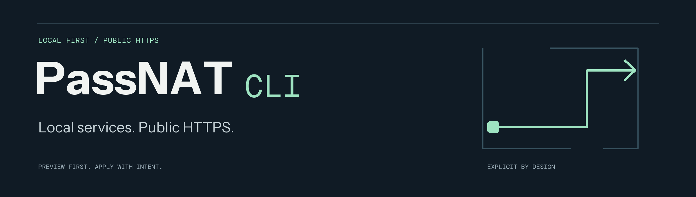
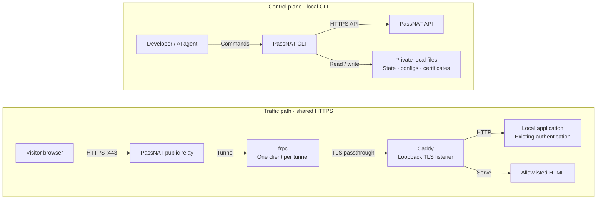

<p align="center">
  
</p>

<h1 align="center">Local services. Public HTTPS.</h1>

<p align="center">
  A PassNAT command-line tool for demos, collaboration, and sharing static pages.<br />
  Share one tunnel across multiple sites. Review changes before applying them.
</p>

<p align="center">
  <strong>English</strong> | <a href="README.zh-CN.md">简体中文</a>
</p>

<p align="center">
  <a href="https://github.com/zxbdzh/passnat-cli/actions/workflows/tests.yml"></a>
  <a href="pyproject.toml"></a>
  <a href="LICENSE"></a>
</p>

<p align="center">
  <a href="#quick-start">Quick start</a> ·
  <a href="#architecture">Architecture</a> ·
  <a href="#install-with-an-ai-assistant">AI-assisted install</a> ·
  <a href="https://zxbdzh.github.io/passnat-cli/">Docs (中文)</a> ·
  <a href="SECURITY.md">Security (中文)</a> ·
  <a href="https://github.com/zxbdzh/passnat-cli/issues">Issues</a>
</p>

> [!NOTE]
> **Unofficial community project.** Not affiliated with PassNAT. Using the service requires your own authorized PassNAT account and SecretKey; installation and offline checks do not require credentials.

## Why PassNAT CLI

Sharing a local feature should not expose an entire directory. Adding another demo should not mean starting another tunnel client that competes for the same connection.

| What you need | How it works |
| :--- | :--- |
| **Let others try a local app** | Caddy serves trusted HTTPS while the app keeps its existing login and permissions. |
| **Share multiple sites** | One shared tunnel, one frpc, one Caddy. Add sites by reloading the existing setup. |
| **Share a few static pages** | Allowlist individual HTML files instead of exposing directory listings, configuration files, or the whole repository. |
| **Automate with scripts or AI** | Structured JSON, explicit exit codes, and dry runs by default for platform resource writes. |
| **Take a demo offline** | Verify recorded ownership and the full mapping parameters before cleanup; do not take over unrecognized resources. |

**Shared by default, dedicated when needed.** Manage shared sites or create a dedicated preview without changing your application's source code.

## Architecture

The CLI is the **control plane**, not a proxy for visitors. It calls the PassNAT API, manages private local state, and generates the frpc and Caddy configuration.



Visitor traffic follows a separate path: **HTTPS client → PassNAT public relay → a single frpc → Caddy's loopback TLS listener → a local HTTP app or allowlisted HTML files**. Caddy handles HTTPS locally; application authentication remains the application's responsibility.

- **One shared tunnel, one client.** Multiple sites share the same managed frpc and Caddy; adding a site does not require another tunnel client.
- **Keep private state out of the public path.** Credentials, generated configuration, certificates, and rollback snapshots belong in the private state directory, never in a site root.
- **Publish only what you intend.** Proxy an app with its existing authentication, or explicitly allowlist the HTML files to serve.

The diagram covers shared HTTPS mode. Dedicated previews have separate configuration and lifecycle. The relay is an external service; its internal implementation is outside this repository.

| Module | Responsibility |
| :--- | :--- |
| [`cli.py`](passnat/cli.py) | Command parsing, dispatch, mutation locking, and structured output. |
| [`core.py`](passnat/core.py) | API client, credentials, private files, ownership checks, and configuration filtering. |
| [`shared.py`](passnat/shared.py) | Shared site registry, Caddy configuration, synchronization, process lifecycle, and public probes. |
| [`preview.py`](passnat/preview.py) | Dedicated preview configuration, process lifecycle, status checks, and safe teardown. |

## Quick start

You need **Python 3.11+** and Git. If you have [uv](https://docs.astral.sh/uv/), install in an isolated tool environment:

```sh
uv tool install --python 3.11 "git+https://github.com/zxbdzh/passnat-cli"
```

No uv? Install from source in your own virtual environment:

```sh
git clone https://github.com/zxbdzh/passnat-cli.git
cd passnat-cli
python -m pip install .
```

Run these checks first. No credentials are needed:

```sh
passnat --version
passnat --help
passnat schema
```

> [!TIP]
> The Python package uses only the standard library at runtime. Creating an HTTPS preview additionally requires your PassNAT credentials and separately installed **frpc** and **Caddy** binaries.

## Install with an AI assistant

Copy this prompt to an AI assistant with terminal access. It asks the assistant to perform the installation and offline checks, not just describe the steps:

```text
Install PassNAT CLI from https://github.com/zxbdzh/passnat-cli on this computer,
and install the repository's skills/passnat-preview skill for the current AI
assistant. Perform the installation rather than only giving me instructions.

1. Read README.md, SECURITY.md, and the skill's SKILL.md. Check the OS, Git,
   Python 3.11+, and any existing CLI or skill installation. Preserve local
   changes; ask before overwriting files or resolving permission conflicts.
2. Use an isolated, user-level installation from that repository. Prefer
   uv tool install --python 3.11 "git+https://github.com/zxbdzh/passnat-cli"
   when uv is available; otherwise use existing pipx or a dedicated venv.
   Do not substitute a similarly named PyPI package or modify system Python.
3. Install the skill using this assistant's confirmed skill conventions.
   If Magpie manages skills, use Magpie Library. Do not change other assistants,
   global permissions, or security settings. Ask if the skill location is unclear.
4. Verify passnat --version, passnat --help, and passnat schema. Check whether
   frpc and Caddy are available; report missing preview dependencies honestly.
5. Installation and offline checks only. Do not read, print, or request secrets,
   copy existing runtime configuration, create tunnels, start persistent services,
   or open public ports. No SecretKey is needed for this task.

Report the CLI and skill locations, check results, missing dependencies, and any
incomplete steps. Explain how I can safely configure my own credentials next.
```

[Full installation prompt — Chinese reference →](https://zxbdzh.github.io/passnat-cli/ai-install.html) · [Installation guide (Chinese)](docs/ai-install.md) · [Agent skill (Chinese)](skills/passnat-preview/SKILL.md)

Installing the CLI and skill does **not** mean the preview environment is ready. The assistant should report the availability of frpc, Caddy, and other prerequisites separately. The linked documentation and skill are currently in Chinese; an English README does not imply that CLI help or error messages are localized.

## From inspection to sharing

Provide `PASSNAT_SECRET_KEY` through a trusted local credential tool, or use `passnat auth login --stdin` on Windows to store a credential protected by the current user's DPAPI. **Never put a real key in command arguments, scripts, or chat.**

```sh
passnat auth check
passnat tunnels list
passnat domains list
```

If you already have a shared setup registered by this tool, add an app with:

```sh
# 1. Dry run: review the domain, mapping, and upstream.
passnat shared site dev demo --subdomain YOUR_SUBDOMAIN --domain-id DOMAIN_ID --upstream-port 8000

# 2. Confirm what will be public, apply, and reload the existing setup.
passnat shared site dev demo --subdomain YOUR_SUBDOMAIN --domain-id DOMAIN_ID --upstream-port 8000 --apply
passnat shared sync dev --reload --apply

# 3. Check the public certificate and target site status.
passnat shared status dev
```

`dev` is an example setup name. Replace uppercase placeholders such as `YOUR_SUBDOMAIN` and `DOMAIN_ID` with resources available to your account. For a first-time setup, expand the initialization guide below.

## Usage guides

<details>
<summary><strong>Shared mode · Initialize a setup and add static pages</strong></summary>

Use a tunnel **created and registered by this tool, with no other client connected**. If you do not have one, create it using the `tunnels create` example under dedicated mode. Available nodes and domain permissions depend on your account.

```sh
# Review the dry run, then initialize.
passnat shared init dev --tunnel TUNNEL_ID
passnat shared init dev --tunnel TUNNEL_ID --apply

# Register the first site: review before applying. At least one site is required.
passnat shared site dev demo --subdomain YOUR_SUBDOMAIN --domain-id DOMAIN_ID --upstream-port 8000
passnat shared site dev demo --subdomain YOUR_SUBDOMAIN --domain-id DOMAIN_ID --upstream-port 8000 --apply
passnat shared sync dev --apply
```

Run each process in the foreground in a separate terminal, or use your project's existing process manager:

```sh
passnat shared run dev proxy
passnat shared run dev frpc
```

To share static HTML only, specify an absolute directory and an explicit file list:

```sh
passnat shared site dev docs --subdomain YOUR_DOCS_SUBDOMAIN --domain-id DOMAIN_ID --root ABSOLUTE_PUBLIC_DIRECTORY --file index.html --file guide.html
```

Review the dry run, repeat the command with `--apply`, then run `shared sync dev --reload --apply`. You do not need a second frpc for the new site.

Caddy uses TLS-ALPN-01 to obtain and renew certificates through public HTTPS port 443. The platform mapping points to the local shared TLS port. A plain HTTP upstream cannot be used directly as an HTTPS endpoint.

</details>

<details>
<summary><strong>Dedicated mode · Create an isolated preview for an app</strong></summary>

Put frpc in `PATH`, set `PASSNAT_FRPC`, or specify it with `preview up --frpc`. Install Caddy with `passnat tools install-caddy`. Dedicated mode also supports `PASSNAT_CADDY`; shared mode uses `bin/caddy.exe` inside the private directory.

```sh
# Create a dedicated tunnel: review, then repeat with --apply.
passnat tunnels create mypreview --node-id NODE_ID --port-name demo-tcp --protocol https --local-port 443 --subdomain YOUR_SUBDOMAIN --domain-id DOMAIN_ID

# Use the tunnel ID returned above; review, then add --apply here too.
passnat preview up demo --tunnel TUNNEL_ID --local-port 8000 --public-port 443 --domain-id DOMAIN_ID --subdomain YOUR_SUBDOMAIN

# Once configured, run each process in a separate terminal.
passnat preview run demo proxy
passnat preview run demo frpc
passnat preview status demo
```

`tools install-caddy` downloads and verifies the binary from the official release source. Automatic installation currently supports Windows amd64 only. This command installs software; it is not a platform resource dry run controlled by `--apply`.

</details>

<details>
<summary><strong>Cleanup and migration · Confirm ownership before taking a site offline</strong></summary>

```sh
passnat ports delete LOCAL_PORT_NAME
passnat preview down demo
```

Review the dry run before adding `--apply`. `ports delete` takes a locally registered name, not a proxy UUID.

**Taking down a dedicated preview may delete its entire dedicated tunnel. The link will stop working; this is not a pause.** Automatic teardown is refused if mapping identities or parameters have changed, other services are present, or ownership records are missing. Do not use `preview down` for an individual shared site.

Read `passnat shared migrate --help` before migrating. The tool keeps private rollback snapshots, but switching domains may briefly interrupt service. If the outcome of a write request is uncertain, reconcile the actual state before retrying.

</details>

<details>
<summary><strong>Scripts and agents · JSON output, exit codes, and the skill</strong></summary>

Successful commands return `{"ok": true, "data": {}, "meta": {}}`; failures return `{"ok": false, "error": {}}`. Process logs go to stderr.

| Exit code | Meaning |
| :---: | :--- |
| `0` | Success |
| `1` | Network, platform API, or runtime error |
| `2` | Authentication error |
| `3` | Argument or ownership validation error |

`passnat schema` describes the output contract. Each resource's `--help` lists its current command arguments.

The bundled [passnat-preview skill (Chinese)](skills/passnat-preview/SKILL.md) describes sharing, verification, and cleanup workflows. Install it according to your agent's skill conventions. The skill contains no credentials and does not automatically install frpc or Caddy.

</details>

## Share links, not secrets

- **Keep private files local.** The default state directory is outside the repository. frpc configuration, certificates, DPAPI files, and migration snapshots are not public deliverables.
- **Keep application authentication.** The app remains responsible for login, cookies, and callback boundaries. This tool does not bypass authentication.
- **Do not compete for a tunnel identity.** Run one managed frpc per tunnel. Do not share the same online identity with a desktop client or another machine.
- **Verify the real public endpoint.** Status checks connect to the platform's public node, preserve the domain's SNI/Host, and validate the certificate. A successful loopback connection is not treated as public success.
- **Redacted does not mean safe to publish.** Arbitrary strings, third-party logs, and application data may still contain sensitive information. Review them before sharing.

The default private directory is `%LOCALAPPDATA%/PassNatCLI` on Windows and `$HOME/.local/share/PassNatCLI` elsewhere. Point `PASSNAT_HOME` only to a private directory accessible to you, never to a repository, shared directory, or site root.

**DPAPI protects stored login credentials only; it does not encrypt all runtime configuration.** See [SECURITY.md (Chinese)](SECURITY.md) for the full security boundaries and reporting instructions.

## Compatibility and verification

| Component | Current status |
| :--- | :--- |
| Python | 3.11+; standard-library-only runtime dependencies. |
| Windows | Primary usage environment; supports DPAPI credential storage. |
| Linux / other systems | Credentials can be supplied through environment variables; verify preview functionality in the target environment. |
| Automated tests | GitHub Actions covers Windows / Ubuntu × Python 3.11 / 3.13. |
| External dependencies | HTTPS previews require frpc, Caddy, and usable PassNAT account resources. |

Unit tests use synthetic data and mocks; they do not create real platform resources. **Passing CI does not verify login, uploads, or playback in a real application.**

## Contributing

Reproducible bug reports and focused improvements are welcome. Include your version, OS, sanitized reproduction steps, and expected behavior. Do not paste keys, full configuration files, or real user data.

```sh
git clone https://github.com/zxbdzh/passnat-cli.git
cd passnat-cli
python -m unittest discover -s tests -v
```

[Report an issue](https://github.com/zxbdzh/passnat-cli/issues/new) · [View tests](https://github.com/zxbdzh/passnat-cli/actions/workflows/tests.yml) · [Security reporting (Chinese)](SECURITY.md#漏洞报告)

If this saves you time setting up previews, a **Star** is appreciated. We'd also like to hear what you want to make simpler next.

---

<p align="center">
  <a href="LICENSE">MIT License</a> · Community maintained. Not an official PassNAT product.<br />
  <sub>PassNAT, frpc, and Caddy retain their respective trademarks, service terms, and licenses.</sub>
</p>
