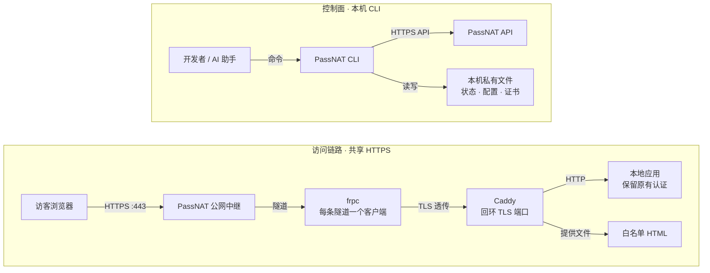

<p align="center">
  
</p>

<h1 align="center">本地服务，一条 HTTPS 链接。</h1>

<p align="center">
  <a href="README.md">English</a> | <strong>简体中文</strong>
</p>

<p align="center">
  为开发演示、临时协作与静态分享而生的 PassNAT 命令行工具。<br />
  多个站点共享一条隧道，先看变更，再决定执行。
</p>

<p align="center">
  <a href="https://github.com/zxbdzh/passnat-cli/actions/workflows/tests.yml"></a>
  <a href="pyproject.toml"></a>
  <a href="LICENSE"></a>
</p>

<p align="center">
  <a href="#快速开始">快速开始</a> ·
  <a href="#项目架构">项目架构</a> ·
  <a href="#让-ai-帮你安装">AI 一键安装</a> ·
  <a href="https://zxbdzh.github.io/passnat-cli/">在线文档</a> ·
  <a href="SECURITY.md">安全说明</a> ·
  <a href="https://github.com/zxbdzh/passnat-cli/issues">反馈问题</a>
</p>

> [!NOTE]
> **非官方社区项目**，与 PassNAT 官方无隶属关系。使用时需自行提供有权限的 PassNAT 账号与 SecretKey；安装与离线自检不需要密钥。

## 为什么是 PassNAT CLI

分享一个本地功能，不应该顺手公开整个目录；新增一个演示，也不应该再启动一个互相争用的隧道客户端。

| 你要做的事 | 工具如何处理 |
| :--- | :--- |
| **把本地应用交给别人体验** | Caddy 提供可信 HTTPS，应用继续使用原有登录与权限。 |
| **同时分享多个站点** | 一条共享隧道、一个 frpc、一个 Caddy，新增站点通过热重载加入。 |
| **只分享几张静态页面** | 逐个指定 HTML 白名单，不开放目录列表、配置文件或整个仓库。 |
| **交给脚本或 AI 操作** | 结构化 JSON、明确退出码，平台资源写操作默认预演。 |
| **结束临时演示** | 核对登记身份和完整映射参数后再回收，不接管来源不明的资源。 |

**共享优先，需要时独立。** 同一套 CLI 同时提供共享站点管理与专用预览，不修改应用业务源码。

## 项目架构

CLI 属于**控制面**：调用 PassNAT API 管理映射，核对归属，并生成保存在本机私有目录中的 frpc 与 Caddy 配置；它本身不代理访客请求。



实际访问路径为：**访客浏览器 → PassNAT 公网中继 → 单一 frpc → Caddy 回环 TLS 端口 → 本地 HTTP 应用或白名单 HTML**。HTTPS 在本机 Caddy 终止；应用继续负责原有登录与权限。

- **一条共享隧道，一个客户端。** 多个站点共用 frpc 与 Caddy，新增站点只需热重载。
- **私有状态不走公开路径。** 凭证、运行配置、证书和回滚快照与站点内容分离。
- **按意图发布。** 反向代理保留原认证，静态分享只允许明确列出的 HTML。

架构图展示共享 HTTPS 模式；独立预览使用单独的配置与生命周期。平台中继属于外部服务，图中并未展开其内部实现。

| 模块 | 职责 |
| :--- | :--- |
| [`cli.py`](passnat/cli.py) | 命令解析、分发、写操作互斥与结构化输出。 |
| [`core.py`](passnat/core.py) | API 客户端、凭证与私有文件、归属校验、配置过滤。 |
| [`shared.py`](passnat/shared.py) | 共享站点登记、Caddy 配置、同步与进程生命周期、公网探测。 |
| [`preview.py`](passnat/preview.py) | 独立预览配置、进程生命周期、状态检查与安全回收。 |

## 快速开始

需要 **Python 3.11+** 和 Git。已有 [uv](https://docs.astral.sh/uv/) 时，使用隔离工具安装：

```sh
uv tool install --python 3.11 "git+https://github.com/zxbdzh/passnat-cli"
```

没有 uv？也可以在自己的虚拟环境里从源码安装：

```sh
git clone https://github.com/zxbdzh/passnat-cli.git
cd passnat-cli
python -m pip install .
```

安装后先做不需要密钥的自检：

```sh
passnat --version
passnat --help
passnat schema
```

> [!TIP]
> Python 包的运行依赖仅使用标准库。真正创建 HTTPS 预览时，才需要你的 PassNAT 凭证，以及额外安装的 **frpc** 和 **Caddy**。

## 让 AI 帮你安装

把这段复制给有终端操作能力的 AI 助手，让它完成安装和离线自检，而不只是返回教程：

```text
请按 https://zxbdzh.github.io/passnat-cli/ai-install.html 的安装说明，直接为当前电脑安装 PassNAT CLI 和当前 AI 的 passnat-preview 技能，并完成离线自检。只安装，不读取密钥、不创建隧道、不开放端口。
```

[完整安装提示词 →](https://zxbdzh.github.io/passnat-cli/ai-install.html) · [仓库内安装说明](docs/ai-install.md) · [Agent 技能](skills/passnat-preview/SKILL.md)

安装 CLI 和技能，不等于预览环境已经就绪；AI 会单独报告 frpc、Caddy 等依赖是否齐备。

## 从查询到分享

先通过可信的本地凭证工具提供 `PASSNAT_SECRET_KEY`，或在 Windows 下使用 `passnat auth login --stdin` 保存当前用户的 DPAPI 加密凭证。**不要把真实密钥写入命令参数、脚本或聊天。**

```sh
passnat auth check
passnat tunnels list
passnat domains list
```

已有本工具登记的共享底座时，新增应用只需：

```sh
# 1. 先预演：核对域名、映射和上游。
passnat shared site dev demo --subdomain YOUR_SUBDOMAIN --domain-id DOMAIN_ID --upstream-port 8000

# 2. 确认公开范围后执行，再热重载已有底座。
passnat shared site dev demo --subdomain YOUR_SUBDOMAIN --domain-id DOMAIN_ID --upstream-port 8000 --apply
passnat shared sync dev --reload --apply

# 3. 检查公网证书与目标站点状态。
passnat shared status dev
```

`dev` 是示例底座名，`YOUR_SUBDOMAIN`、`DOMAIN_ID` 等大写标识需要替换为当前账号实际资源。首次使用请展开下面的初始化步骤。

## 使用指南

<details>
<summary><strong>共享模式 · 初始化底座与添加静态页面</strong></summary>

选用**本工具创建并登记、没有其他客户端占用**的隧道。没有这样的隧道时，先按独立模式中的 `tunnels create` 示例创建；节点和域名权限以当前账号为准。

```sh
# 先预演，再执行初始化。
passnat shared init dev --tunnel TUNNEL_ID
passnat shared init dev --tunnel TUNNEL_ID --apply

# 登记首个站点：检查预演后执行，底座至少需要一个站点。
passnat shared site dev demo --subdomain YOUR_SUBDOMAIN --domain-id DOMAIN_ID --upstream-port 8000
passnat shared site dev demo --subdomain YOUR_SUBDOMAIN --domain-id DOMAIN_ID --upstream-port 8000 --apply
passnat shared sync dev --apply
```

在两个独立终端或项目既有进程管理器中，分别前台运行：

```sh
passnat shared run dev proxy
passnat shared run dev frpc
```

只分享静态 HTML 时，用绝对目录和明确文件列表：

```sh
passnat shared site dev docs --subdomain YOUR_DOCS_SUBDOMAIN --domain-id DOMAIN_ID --root ABSOLUTE_PUBLIC_DIRECTORY --file index.html --file guide.html
```

检查预演后重复命令并添加 `--apply`，再执行 `shared sync dev --reload --apply`。不需要为新站点启动第二个 frpc。

Caddy 使用 TLS-ALPN-01 为公网 HTTPS 443 申请和续期证书，平台映射指向本机共享 TLS 端口。普通 HTTP 上游不能直接当成 HTTPS 端口使用。

</details>

<details>
<summary><strong>独立模式 · 为需要隔离的应用创建专用预览</strong></summary>

frpc 可放入 `PATH`、由 `PASSNAT_FRPC` 提供，或通过 `preview up --frpc` 指定。Caddy 可使用 `passnat tools install-caddy` 安装；独立模式也支持 `PASSNAT_CADDY`，共享模式使用私有目录中的 `bin/caddy.exe`。

```sh
# 创建专用隧道：先预演，确认后重复命令并添加 --apply。
passnat tunnels create mypreview --node-id NODE_ID --port-name demo-tcp --protocol https --local-port 443 --subdomain YOUR_SUBDOMAIN --domain-id DOMAIN_ID

# 使用创建后返回的隧道 ID；同样先预演，再添加 --apply。
passnat preview up demo --tunnel TUNNEL_ID --local-port 8000 --public-port 443 --domain-id DOMAIN_ID --subdomain YOUR_SUBDOMAIN

# 配置完成后，在两个独立终端分别运行。
passnat preview run demo proxy
passnat preview run demo frpc
passnat preview status demo
```

`tools install-caddy` 从官方发行地址下载并校验程序，当前自动安装只支持 Windows amd64。该命令会安装软件，不属于 `--apply` 控制的平台资源预演。

</details>

<details>
<summary><strong>回收与迁移 · 先确认归属，再停止分享</strong></summary>

```sh
passnat ports delete LOCAL_PORT_NAME
passnat preview down demo
```

核对预演后再添加 `--apply`。`ports delete` 接受本地登记名，不是代理 UUID。

**独立预览下线可能删除整个专用隧道，链接会失效，并非暂停。** 映射身份或参数变化、出现其他服务、缺少归属记录时拒绝自动下线。共享单站点不能使用 `preview down`。

迁移前阅读 `passnat shared migrate --help`。工具保存私有回滚快照，但域名切换可能短暂中断；写请求结果不确定时先对账，不盲目重发。

</details>

<details>
<summary><strong>脚本与 Agent · JSON 输出、退出码与技能</strong></summary>

成功返回 `{"ok": true, "data": {}, "meta": {}}`，失败返回 `{"ok": false, "error": {}}`。运行进程日志使用 stderr。

| 退出码 | 含义 |
| :---: | :--- |
| `0` | 成功 |
| `1` | 网络、平台 API 或运行错误 |
| `2` | 鉴权错误 |
| `3` | 参数或归属校验错误 |

`passnat schema` 提供输出约定；各资源的 `--help` 提供当前命令参数。

随仓库提供的 [passnat-preview 技能](skills/passnat-preview/SKILL.md) 描述共享、验证和回收流程。按当前 Agent 的技能约定安装；技能本身不包含凭证，也不会自动安装 frpc 或 Caddy。

</details>

## 公开链接，不公开密钥

- **私有文件留在本机。** 默认状态目录位于仓库外；frpc 配置、证书、DPAPI 文件和迁移快照不属于公开交付。
- **保留原应用认证。** 登录、Cookie 与回调边界继续由应用负责，本工具不提供绕过认证的能力。
- **不争用隧道身份。** 一条隧道只运行一个受管 frpc，不与桌面客户端或其他机器共用同一在线身份。
- **按真实公网验证。** 状态检查连接平台公网节点，保留域名 SNI/Host 并校验证书，不把回环直连当作公网成功。
- **脱敏不等于可以直接公开。** 任意文本字符串、第三方日志和业务数据仍可能含敏感信息，分享前需人工检查。

默认私有目录：Windows 为 `%LOCALAPPDATA%/PassNatCLI`，其他系统为 `$HOME/.local/share/PassNatCLI`。`PASSNAT_HOME` 只能指向本人可访问的私有目录，不要指向仓库、共享目录或站点根目录。

**DPAPI 只保护保存的登录凭证，不会加密全部运行配置。** 完整边界与报告方式见 [SECURITY.md](SECURITY.md)。

## 兼容性与验证

| 项目 | 当前状态 |
| :--- | :--- |
| Python | 3.11+；运行依赖仅使用标准库。 |
| Windows | 主要使用环境；支持 DPAPI 凭证保存。 |
| Linux / 其他系统 | 可通过环境变量提供凭证；预览能力需在目标环境实测。 |
| 自动测试 | GitHub Actions 覆盖 Windows / Ubuntu × Python 3.11 / 3.13。 |
| 外部依赖 | HTTPS 预览需要 frpc、Caddy 与可用的 PassNAT 账号资源。 |

单元测试使用合成数据和 mock，不创建真实平台资源。**CI 通过不等于真实应用的登录、上传或播放已经验收。**

## 参与项目

欢迎提交可复现的问题和范围清楚的改进。反馈时请附版本、系统、脱敏复现步骤与期望行为；不要粘贴密钥、完整配置或真实用户信息。

```sh
git clone https://github.com/zxbdzh/passnat-cli.git
cd passnat-cli
python -m unittest discover -s tests -v
```

[提交问题](https://github.com/zxbdzh/passnat-cli/issues/new) · [查看测试](https://github.com/zxbdzh/passnat-cli/actions/workflows/tests.yml) · [安全报告说明](SECURITY.md#漏洞报告)

如果它帮你省下了反复配置预览的时间，欢迎点一颗 **Star**，也欢迎告诉我们你最想简化的下一步。

---

<p align="center">
  <a href="LICENSE">MIT License</a> · 社区维护，非 PassNAT 官方产品<br />
  <sub>PassNAT 服务、frpc 和 Caddy 的商标、服务条款及许可证分别归各自权利人所有。</sub>
</p>
