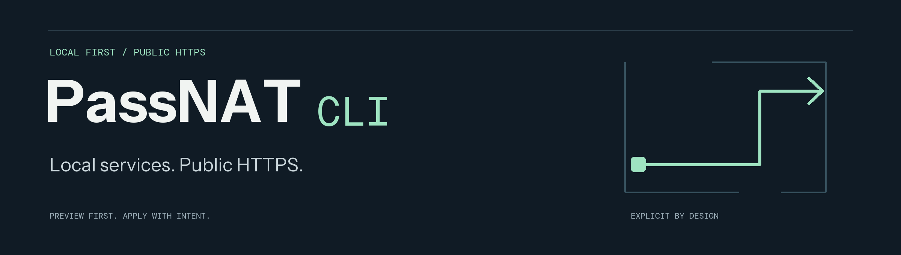
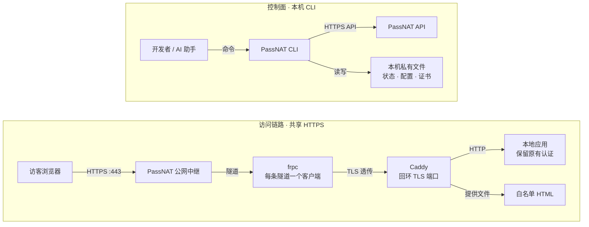

<p align="center">
  
</p>

<h1 align="center">本地服务，一条 HTTPS 链接。</h1>

<p align="center">
  <a href="README.md">English</a> | <strong>简体中文</strong>
</p>

<p align="center">
  为开发演示、临时协作与静态分享而生的 PassNAT 命令行工具。<br />
  多个站点共享一条隧道，先看变更，再决定执行。
</p>

<p align="center">
  <a href="https://github.com/zxbdzh/passnat-cli/actions/workflows/tests.yml"></a>
  <a href="pyproject.toml"></a>
  <a href="LICENSE"></a>
</p>

<p align="center">
  <a href="#快速开始">快速开始</a> ·
  <a href="#项目架构">项目架构</a> ·
  <a href="#让-ai-帮你安装">AI 一键安装</a> ·
  <a href="https://zxbdzh.github.io/passnat-cli/">在线文档</a> ·
  <a href="SECURITY.md">安全说明</a> ·
  <a href="https://github.com/zxbdzh/passnat-cli/issues">反馈问题</a>
</p>

> [!NOTE]
> **非官方社区项目**，与 PassNAT 官方无隶属关系。使用时需自行提供有权限的 PassNAT 账号与 SecretKey；安装与离线自检不需要密钥。

## 为什么是 PassNAT CLI

分享一个本地功能，不应该顺手公开整个目录；新增一个演示，也不应该再启动一个互相争用的隧道客户端。

| 你要做的事 | 工具如何处理 |
| :--- | :--- |
| **把本地应用交给别人体验** | Caddy 提供可信 HTTPS，应用继续使用原有登录与权限。 |
| **同时分享多个站点** | 一条共享隧道、一个 frpc、一个 Caddy，新增站点通过热重载加入。 |
| **只分享几张静态页面** | 逐个指定 HTML 白名单，不开放目录列表、配置文件或整个仓库。 |
| **交给脚本或 AI 操作** | 结构化 JSON、明确退出码，平台资源写操作默认预演。 |
| **结束临时演示** | 核对登记身份和完整映射参数后再回收，不接管来源不明的资源。 |

**共享优先，需要时独立。** 同一套 CLI 同时提供共享站点管理与专用预览，不修改应用业务源码。

## 分流规则

先确认场景，再创建资源。拿不准时先跑本地规划器——它不读凭证、不联网、不写状态：

```sh
passnat plan --device same --protocol https --apps 2
```

| 场景 | 使用 | 不要 |
| :--- | :--- | :--- |
| **同一设备、多个 HTTPS 应用** | 复用一套底座：`shared site` 登记，`shared sync --reload --apply` 热加载；首条映射用 `tunnels create --caddy-tls-port` | 不要为第二个应用再建一条隧道或第二个 frpc |
| **同一设备、单个 HTTPS 应用** | 独立 `preview up`：先用 `tunnels create --port-name <NAME>-tcp --caddy-tls-port 443` 登记隧道首条映射，执行 `preview up NAME --public-port 443 ... --apply`，再启动 `preview run NAME proxy` 和 `preview run NAME frpc` | 不要自动套用共享复用 |
| **HTTP / TCP / UDP** | HTTP：`tunnels create --protocol http`；TCP：在已有隧道上用 `ports add --protocol tcp --remote-port …`，TCP 不能作为 `tunnels create` 的首条映射；UDP 当前不支持，CLI 返回 `unsupported_protocol` | 不要进入 Caddy HTTPS 共享流程，也不要假装 TCP 能作为首条映射或 UDP 可用 |
| **不同设备** | 目标设备独立建隧道与独立 frpc 身份 | 不要复用同一隧道 ID、frpc 配置或进程身份 |

同一本机端口号不构成冲突：归属按登记名 `port_name` 判定，不按数字端口判定。

## 项目架构

CLI 属于**控制面**：调用 PassNAT API 管理映射，核对归属，并生成保存在本机私有目录中的 frpc 与 Caddy 配置；它本身不代理访客请求。



实际访问路径为：**访客浏览器 → PassNAT 公网中继 → 单一 frpc → Caddy 回环 TLS 端口 → 本地 HTTP 应用或白名单 HTML**。HTTPS 在本机 Caddy 终止；应用继续负责原有登录与权限。

- **一条共享隧道，一个客户端。** 多个站点共用 frpc 与 Caddy，新增站点只需热重载。
- **私有状态不走公开路径。** 凭证、运行配置、证书和回滚快照与站点内容分离。
- **按意图发布。** 反向代理保留原认证，静态分享只允许明确列出的 HTML。

架构图展示共享 HTTPS 模式；独立预览使用单独的配置与生命周期。平台中继属于外部服务，图中并未展开其内部实现。

| 模块 | 职责 |
| :--- | :--- |
| [`cli.py`](passnat/cli.py) | 命令解析、分发、写操作互斥与结构化输出。 |
| [`core.py`](passnat/core.py) | API 客户端、凭证与私有文件、归属校验、配置过滤。 |
| [`shared.py`](passnat/shared.py) | 共享站点登记、Caddy 配置、同步与进程生命周期、公网探测。 |
| [`preview.py`](passnat/preview.py) | 独立预览配置、进程生命周期、状态检查与安全回收。 |

## 快速开始

需要 **Python 3.11+** 和 Git。已有 [uv](https://docs.astral.sh/uv/) 时，使用隔离工具安装：

```sh
uv tool install --python 3.11 "git+https://github.com/zxbdzh/passnat-cli"
```

没有 uv？也可以在自己的虚拟环境里从源码安装：

```sh
git clone https://github.com/zxbdzh/passnat-cli.git
cd passnat-cli
python -m pip install .
```

安装后先做不需要密钥的自检：

```sh
passnat --version
passnat --help
passnat schema
```

> [!TIP]
> Python 包的运行依赖仅使用标准库。真正创建 HTTPS 预览时，还需要你的 PassNAT 凭证、**frpc** 可执行文件（macOS 上由 PassNAT.app 自带），以及受管 **Caddy**。Caddy 不需要你手工下载安装：`passnat tools install-caddy` 会下载固定官方构建、校验摘要后写入 CLI 私有状态目录，再由 CLI 的 `run … proxy` 前台托管。macOS 上不使用 Homebrew 或手工安装；只装 CLI 和技能，**不等于**已经装好 Caddy。

## 让 AI 帮你安装

把这段复制给有终端操作能力的 AI 助手，让它完成安装和离线自检，而不只是返回教程：

```text
请按 https://zxbdzh.github.io/passnat-cli/ai-install.html 的安装说明，直接为当前电脑安装 PassNAT CLI 和当前 AI 的 passnat-preview 技能，并完成离线自检。只安装，不读取密钥、不创建隧道、不开放端口。
```

[完整安装提示词 →](https://zxbdzh.github.io/passnat-cli/ai-install.html) · [仓库内安装说明](docs/ai-install.md) · [Agent 技能](skills/passnat-preview/SKILL.md)

安装 CLI 和技能，不等于预览环境已经就绪；AI 会单独报告 frpc、Caddy 等依赖是否齐备。

## 平台依赖

### macOS 安装 Caddy

PassNAT.app 自带 frpc，但不含 Caddy。macOS 由 CLI 托管自己的 Caddy，且**仅支持 Apple Silicon（arm64）**。安装固定官方版本：

```sh
passnat tools install-caddy
```

该命令下载官方 GitHub Release 资产 `caddy_2.11.9_mac_arm64.tar.gz`，校验固定 SHA-256，之后只从归档中读取常规文件 `caddy`（不做通用解压），写入 CLI 私有状态目录并赋予可执行权限（默认 `~/.local/share/PassNatCLI/bin/caddy`，可用 `PASSNAT_HOME` 改根目录）。重复执行是安全的：摘要一致的已有文件会复用；路径上内容不同或是符号链接时直接拒绝，不覆盖。macOS 上**不会**回退到 Intel 构建、Homebrew、`PASSNAT_CADDY` 或 `PATH`，只运行这个受管文件。

Linux 等没有受管构建的系统（`passnat tools install-caddy` 不支持）上，CLI 改为查找 `PASSNAT_CADDY`、`<状态目录>/bin/caddy` 或 `PATH` 中的 `caddy`。

frpc 优先从 PassNAT.app 自动发现；应用位于非标准目录时设置 `PASSNAT_FRPC=/绝对路径/frpc`。

### 用 CLI 托管的 Caddy 运行与共享

Caddy 由本 CLI 安装并托管，不依赖 Homebrew：`passnat tools install-caddy` 把校验过摘要的文件放进私有状态目录，`passnat shared run … proxy`（或 `passnat preview run … proxy`）再以前台进程启动它，因此没有系统服务或 LaunchAgent 需要配置。

单个应用用 `passnat preview up` / `passnat preview run NAME proxy`。要让多个应用共用一个 TLS 入口，隧道的**首条映射**必须指向共享 Caddy 的 TLS 端口：先显式用 `--caddy-tls-port PORT` 创建该映射，再把**同一个值**传给 `shared init --tls-port PORT`（后者默认是 `18446`；`--caddy-tls-port` 不会隐式选择端口）：

```sh
# 首条映射与共享底座必须使用同一个 TLS 端口。
# 先核对这次预演，再给同一条 create 命令加 --apply 执行，然后运行 init。
passnat tunnels create dev --node-id NODE_ID --port-name dev-base \
  --caddy-tls-port 18446 --subdomain BASE_SUBDOMAIN --domain-id DOMAIN_ID
passnat shared init dev --tunnel TUNNEL_ID --tls-port 18446 --apply

passnat shared site dev app1 --subdomain SUB1 --domain-id DOMAIN_ID --upstream-port 5000 --apply
passnat shared site dev app2 --subdomain SUB2 --domain-id DOMAIN_ID --upstream-port 8001 --apply
# 首次运行只写入并校验，不要加 --reload。
passnat shared sync dev --apply
```

在两个前台终端里启动进程，**先 Caddy、后 frpc**：

```sh
passnat shared run dev proxy   # 先等 18446 开始监听
passnat shared run dev frpc
```

`shared init` 不会校验首条映射的 `local_port` 是否等于 `--tls-port`；生成的 frpc 配置直接转发隧道已有映射，所以端口不一致只会在 frpc 启动时表现为 `connection refused`。`passnat shared sync dev --reload --apply` 只在底座**已经运行**、需要新增站点时使用：`--reload` 会先确认运行中的 Caddy 实例属于本底座，再热重载 Caddy 与 frpc。不要同时运行独立预览和共享底座，两者会争用公网 80/443。应用保持普通 HTTP 上游，TLS 由 Caddy 在前端终结。

### 为 CLI 托管的 Caddy 登记 PassNAT 映射

`preview up` 会创建或复用自家的 `<preview-name>-tcp` 映射（公网端口不是 `443` 时再加 `<preview-name>-http`），`shared site` 负责站点映射，而 `shared init` **不创建任何映射**——它只登记共享底座，并要求隧道首条映射已经指向 TLS 端口。若手工登记，先查看隧道当前映射，确认哪些记录属于本工具：

```sh
passnat tunnels get --tunnel TUNNEL_ID
```

如果已经存在错误映射——例如旧命令省略协议，用应用 HTTP 端口创建了首个 HTTP 映射——先停下核对归属。该记录属于现有隧道；只有在代理名/ID 与隧道归属都确认后，才用 `passnat ports delete NAME` 预演并有意删除或替换。不要放着错误映射不管，也不要假定 CLI 会自动清理，更不要直接再建一条把问题掩盖过去。

显式创建 HTTPS 映射。`--caddy-tls-port` 一步固定本地端口为该 TLS 监听、`protocol=https`、`remote_port=443`，不存在 HTTP 回退：

```sh
# 示例：共享底座中，受管 Caddy 在回环 18446 上提供 TLS（默认值）。
passnat tunnels create mycaddy --node-id NODE_ID --port-name caddy-tcp --caddy-tls-port 18446 --subdomain YOUR_SUBDOMAIN --domain-id DOMAIN_ID
```

核对预演：`protocol` 必须是 `https`，`remote_port` 必须是 `443`，`local_port` 必须是 Caddy 的 TLS 端口。不要把应用 HTTP 端口（例如 8000）填在这里；Caddy 自己会反代到该端口。`--caddy-tls-port` 与 `--local-port`、`--protocol`、`--local-tls` 互斥；它也**不是** `shared init --tls-port`——但在共享底座中两者必须取同一个值（默认 `18446`）。后文出现的 `443` 只属于独立预览：那里的 Caddy TLS 监听端口本身就是公网端口。

域名必须解析到可访问的公网入口。Caddy 自动申请/续期公开证书需要对应 ACME 挑战端口可达；TLS-ALPN-01 用 TCP 443，HTTP-01 用 TCP 80。若流量经 PassNAT frpc，需确保 PassNAT 映射把公网 443/80 转发到运行此 Caddy 实例的本机端口；单有 Caddy 本地监听并不会自动创建 PassNAT 隧道。生产分享优先映射公网 443，避免访问 URL 需要带端口。

不需要事先已有公信证书：DNS 与挑战路径可达后，Caddy 会通过 ACME 自行申请。预演只证明映射 payload 正确，不证明本地端口真的讲 TLS、Caddy 已在监听，也不证明 ACME 挑战流量能穿过 frpc；这些要分别用 `passnat preview status`、`passnat shared status`、`lsof -nP -iTCP:18446 -sTCP:LISTEN`（共享 TLS 端口；独立预览用 `:443`）和真实 HTTPS 请求验证。

## 从查询到分享

先通过可信的本地凭证工具提供 `PASSNAT_SECRET_KEY`，或在 macOS / Windows 下使用 `passnat auth login --stdin`，分别保存到 macOS 钥匙串或当前用户的 DPAPI 加密凭证。**不要把真实密钥写入命令参数、脚本或聊天。**

```sh
passnat auth check
passnat tunnels list
passnat domains list
```

已有本工具登记的共享底座时，新增应用只需：

```sh
# 1. 先预演：核对域名、映射和上游。
passnat shared site dev demo --subdomain YOUR_SUBDOMAIN --domain-id DOMAIN_ID --upstream-port 8000

# 2. 确认公开范围后执行，再热重载已有底座。
passnat shared site dev demo --subdomain YOUR_SUBDOMAIN --domain-id DOMAIN_ID --upstream-port 8000 --apply
passnat shared sync dev --reload --apply

# 3. 检查公网证书与目标站点状态。
passnat shared status dev
```

`dev` 是示例底座名，`YOUR_SUBDOMAIN`、`DOMAIN_ID` 等大写标识需要替换为当前账号实际资源。首次使用请展开下面的初始化步骤。

## 使用指南

<details>
<summary><strong>共享模式 · 初始化底座与添加静态页面</strong></summary>

选用**本工具创建并登记、没有其他客户端占用**的隧道。没有这样的隧道时，先用 `tunnels create --caddy-tls-port PORT` 显式指定你选定的 Caddy TLS 端口作为首个映射，并把同一个值传给 `shared init --tls-port`（默认 `18446`）。`shared init` 不校验首条映射的 `local_port`，不一致只会在 frpc 启动时报 `connection refused`。可参考独立模式示例。节点和域名权限以当前账号为准。

```sh
# 先预演，再执行初始化。--tls-port 必须等于首条映射的 --caddy-tls-port。
passnat shared init dev --tunnel TUNNEL_ID --tls-port 18446
passnat shared init dev --tunnel TUNNEL_ID --tls-port 18446 --apply

# 登记首个站点：检查预演后执行，底座至少需要一个站点。
passnat shared site dev demo --subdomain YOUR_SUBDOMAIN --domain-id DOMAIN_ID --upstream-port 8000
passnat shared site dev demo --subdomain YOUR_SUBDOMAIN --domain-id DOMAIN_ID --upstream-port 8000 --apply
passnat shared sync dev --apply
```

在两个独立终端或项目既有进程管理器中，分别前台运行。先启动 `proxy`，确认 TLS 端口（`18446`）已监听，再启动 `frpc`：

```sh
passnat shared run dev proxy   # 先确认 18446 已监听
passnat shared run dev frpc
```

只分享静态 HTML 时，用绝对目录和明确文件列表：

```sh
passnat shared site dev docs --subdomain YOUR_DOCS_SUBDOMAIN --domain-id DOMAIN_ID --root ABSOLUTE_PUBLIC_DIRECTORY --file index.html --file guide.html
```

检查预演后重复命令并添加 `--apply`；底座尚未运行时执行 `shared sync dev --apply`，Caddy 与 frpc 已在运行时才执行 `shared sync dev --reload --apply`。不需要为新站点启动第二个 frpc。

Caddy 使用 TLS-ALPN-01 为公网 HTTPS 443 申请和续期证书，平台映射指向本机共享 TLS 端口。`--upstream-port` 指向应用自己的 **HTTP** 端口，TLS 由 Caddy 终结；不要把它改成 Caddy 的 TLS 端口，也不要手工声明为 HTTPS 映射。

</details>

<details>
<summary><strong>独立模式 · 为需要隔离的应用创建专用预览</strong></summary>

frpc / Caddy 路径按上面的平台说明探测。下面使用独立预览示例；先登录并用 `passnat auth check` 验证凭证，再确认应用已监听目标本机端口。所有平台写操作先看预演输出，核对后才加 `--apply`：

```sh
# 先确认受管 Caddy 已就位。
# macOS / Linux：
ls -l "${PASSNAT_HOME:-$HOME/.local/share/PassNatCLI}/bin/caddy"
# Windows PowerShell：
# Get-Item "$(if ($env:PASSNAT_HOME) { $env:PASSNAT_HOME } else { "$env:LOCALAPPDATA\PassNatCLI" })\bin\caddy.exe"
passnat --help

# 创建专用隧道：先预演，核对节点、域名和映射，再加 --apply 执行。
# --caddy-tls-port 表示 Caddy 自己的 TLS 监听端口：固定 local_port=443、protocol=https、
# remote_port=443，不存在 HTTP 回退。应用的 HTTP 端口不会出现在这条命令里，
# 由下面的 preview up 通过 --local-port 指定。
# --port-name 必须是 <preview-name>-tcp：preview demo 会复用名为 demo-tcp 的映射。
passnat tunnels create mypreview --node-id NODE_ID --port-name demo-tcp --caddy-tls-port 443 --subdomain YOUR_SUBDOMAIN --domain-id DOMAIN_ID

# 预览名是 demo，因此它会查找 demo-http / demo-tcp。
# 该 --caddy-tls-port 衔接方式仅适用于 --public-port 443；--local-port 是应用的普通 HTTP 端口。
passnat preview up demo --tunnel TUNNEL_ID --local-port 8000 --public-port 443 --domain-id DOMAIN_ID --subdomain YOUR_SUBDOMAIN
```

两条命令必须使用同一套身份：`passnat preview up demo` 在 `443` 公网端口下会复用登记为 `demo-tcp` 的映射，所以首个 `--port-name` 必须是 `<preview-name>-tcp`——`preview demo` 对应 `demo-tcp`，不能随意改名。两条命令的 `--subdomain`、`--domain-id` 必须一致，且 `--caddy-tls-port` 与 `--public-port` 必须同为 `443`（`--caddy-tls-port` 固定创建 `protocol=https`、`remote_port=443`；非 443 高端口预览则要求首条映射为 `<preview-name>-http` 的 `http` 映射，再由 `preview up` 新建裸 `tcp` 映射）。`--local-port` 永远指应用自己的普通 HTTP 端口，不是 TLS 监听。`preview up` 与其他写操作一样，核对预演后加 `--apply` 才真正写入。

**`--protocol https` 的含义是「本地端口本身就是 TLS」。** 普通 HTTP 应用（例如监听 5000 或 8000 的开发服务器）直接声明为 HTTPS 映射，访客会连到明文端口，表现为协议错配。这类应用应使用 `passnat shared site --upstream-port` 或 `passnat preview up`，由本地 Caddy 终结 TLS。`ports add --protocol https` 与 `tunnels create --protocol https` 因此要求同时加 `--local-tls` 确认本地端口已是 TLS 监听，否则在读取凭证和发起请求之前就以退出码 3 拒绝。

`tunnels create` 还要求显式给出 `--protocol`。遗漏时会以 `protocol_required`（退出码 3）在读取凭证前失败，缺省不再静默创建 HTTP 首映射。目标是 Caddy 的 TLS 监听时，用 `--caddy-tls-port PORT` 这个预定义入口：它固定写入 `local_port=PORT`、`protocol=https`、`remote_port=443`，不存在 HTTP 回退。

配置成功后，在两个独立终端分别启动进程（这会建立公网预览）：

```sh
passnat preview run demo proxy
passnat preview run demo frpc
```

之后检查证书和公网目标：

```sh
passnat preview status demo
```

`passnat tools install-caddy` 在 Windows amd64 与 macOS Apple Silicon（arm64）上安装官方 Caddy v2.11.9：先校验 Release 校验和，再写入 CLI 私有状态目录，不依赖 Homebrew 或其他系统级包管理器。

</details>

<details>
<summary><strong>回收与迁移 · 先确认归属，再停止分享</strong></summary>

```sh
passnat ports delete LOCAL_PORT_NAME
passnat preview down demo
```

核对预演后再添加 `--apply`。`ports delete` 接受本地登记名，不是代理 UUID。

**独立预览下线可能删除整个专用隧道，链接会失效，并非暂停。** 映射身份或参数变化、出现其他服务、缺少归属记录时拒绝自动下线。共享单站点不能使用 `preview down`。

若远端隧道已删除，但本地 `create-*`、`port-*`、`shared-*` 或导出记录仍阻塞重用，先按隧道 ID 确认远端删除，并确认受管进程已停止。经用户授权后，只删除 ID 或所属代理 UUID 确实匹配该旧隧道的记录；保留其他隧道状态和锁文件。不要手改旧 ID 让 CLI 接管另一条隧道。

迁移前阅读 `passnat shared migrate --help`。工具保存私有回滚快照，但域名切换可能短暂中断；写请求结果不确定时先对账，不盲目重发。

</details>

<details>
<summary><strong>脚本与 Agent · JSON 输出、退出码与技能</strong></summary>

成功返回 `{"ok": true, "data": {}, "meta": {}}`，失败返回 `{"ok": false, "error": {}}`。运行进程日志使用 stderr。

| 退出码 | 含义 |
| :---: | :--- |
| `0` | 成功 |
| `1` | 网络、平台 API 或运行错误 |
| `2` | 鉴权错误 |
| `3` | 参数或归属校验错误 |

`passnat schema` 提供输出约定；各资源的 `--help` 提供当前命令参数。

随仓库提供的 [passnat-preview 技能](skills/passnat-preview/SKILL.md) 描述共享、验证和回收流程。按当前 Agent 的技能约定安装；技能本身不包含凭证，也不会自动安装 frpc 或 Caddy。

</details>

## 本机 macOS 实测闭环（5000 → HTTPS）

本机 HTTP 应用不需要自己提供 TLS。用受管 Caddy 终结 TLS，再由 PassNAT/frpc 转发：

```sh
passnat tools install-caddy
passnat auth check

# 先预演：首条映射必须是 Caddy TLS 端口，不是应用 5000
passnat tunnels create mac5000 --node-id NODE_ID --port-name mac5000-base \
  --caddy-tls-port 18446 --subdomain BASE_SUBDOMAIN --domain-id DOMAIN_ID
# 核对 protocol=https、local_port=18446、remote_port=443 后再执行同一条命令
passnat tunnels create mac5000 --node-id NODE_ID --port-name mac5000-base \
  --caddy-tls-port 18446 --subdomain BASE_SUBDOMAIN --domain-id DOMAIN_ID --apply

passnat shared init mac5000 --tunnel TUNNEL_ID --tls-port 18446 --apply
passnat shared site mac5000 app --subdomain APP_SUBDOMAIN --domain-id DOMAIN_ID \
  --upstream-port 5000 --apply
passnat shared sync mac5000 --apply
```

配置完成后必须保持两个前台终端运行，**先 Caddy、后 frpc**：

```sh
passnat shared run mac5000 proxy   # 先确认 18446 已监听
passnat shared run mac5000 frpc
```

验证不能只看本地页面：

```sh
passnat shared status mac5000
curl -fsS https://APP_SUBDOMAIN.odn.cc/
```

交付标准是 `connected: true`、`tls_verified: true`，以及公网首页真实状态码（通常 `200`；应用若先跳登录则记录 `3xx`）。如果 frpc 报 `connect to local service 127.0.0.1:18446 ... connection refused`，先启动或检查 `proxy`，不要重建隧道。macOS Caddy 上游必须写 `127.0.0.1:5000`，不能写 `localhost:5000`，否则可能解析到 `::1` 并命中 AirTunes。

## 公开链接，不公开密钥

- **私有文件留在本机。** 默认状态目录位于仓库外；frpc 配置、证书、保存的凭证和迁移快照不属于公开交付。
- **保留原应用认证。** 登录、Cookie 与回调边界继续由应用负责，本工具不提供绕过认证的能力。
- **不争用隧道身份。** 一条隧道只运行一个受管 frpc，不与桌面客户端或其他机器共用同一在线身份。
- **按真实公网验证。** 状态检查连接平台公网节点，保留域名 SNI/Host 并校验证书，不把回环直连当作公网成功。
- **脱敏不等于可以直接公开。** 任意文本字符串、第三方日志和业务数据仍可能含敏感信息，分享前需人工检查。

默认私有目录：Windows 为 `%LOCALAPPDATA%/PassNatCLI`，其他系统为 `$HOME/.local/share/PassNatCLI`。`PASSNAT_HOME` 只能指向本人可访问的私有目录，不要指向仓库、共享目录或站点根目录。

**保存的登录凭证仅由 macOS 钥匙串或 Windows DPAPI 保护，该保护不覆盖全部运行配置。** 完整边界与报告方式见 [SECURITY.md](SECURITY.md)。

## 兼容性与验证

| 项目 | 当前状态 |
| :--- | :--- |
| Python | 3.11+；运行依赖仅使用标准库。 |
| Windows | 主要使用环境；支持 DPAPI 凭证保存。 |
| macOS | 支持保存到登录钥匙串（`passnat auth login --stdin`）。 |
| Linux / 其他系统 | 可通过环境变量提供凭证；`auth login --stdin` 会直接拒绝且不读取输入。 |
| 自动测试 | GitHub Actions 覆盖 Windows / Ubuntu × Python 3.11 / 3.13。 |
| 外部依赖 | HTTPS 预览需要 frpc、Caddy 与可用的 PassNAT 账号资源。 |

单元测试使用合成数据和 mock，不创建真实平台资源。**CI 通过不等于真实应用的登录、上传或播放已经验收。**

## 参与项目

欢迎提交可复现的问题和范围清楚的改进。反馈时请附版本、系统、脱敏复现步骤与期望行为；不要粘贴密钥、完整配置或真实用户信息。

```sh
git clone https://github.com/zxbdzh/passnat-cli.git
cd passnat-cli
python -m unittest discover -s tests -v
```

[提交问题](https://github.com/zxbdzh/passnat-cli/issues/new) · [查看测试](https://github.com/zxbdzh/passnat-cli/actions/workflows/tests.yml) · [安全报告说明](SECURITY.md#漏洞报告)

如果它帮你省下了反复配置预览的时间，欢迎点一颗 **Star**，也欢迎告诉我们你最想简化的下一步。

---

<p align="center">
  <a href="LICENSE">MIT License</a> · 社区维护，非 PassNAT 官方产品<br />
  <sub>PassNAT 服务、frpc 和 Caddy 的商标、服务条款及许可证分别归各自权利人所有。</sub>
</p>
